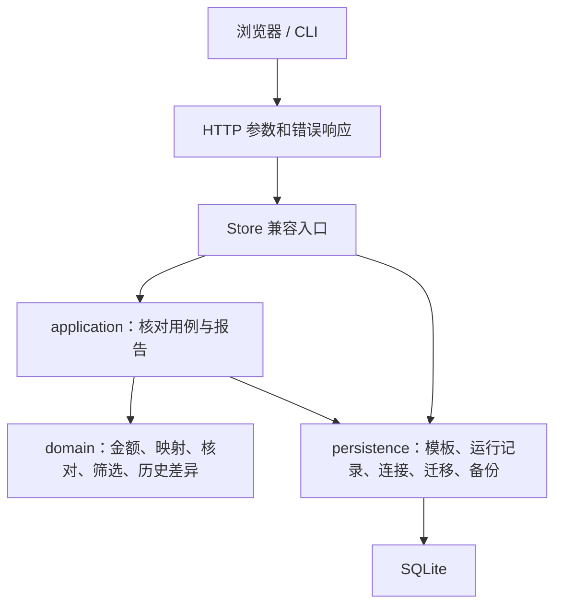

# LedgerDesk 0.4 架构与契约

项目保持 Python 标准库运行方式，按实际职责逐步拆分。`store.py` 仍提供旧调用入口，HTTP、CLI 和已有测试不需要同时改写。



## 模块职责

| 模块 | 职责 |
| --- | --- |
| `domain/money.py` | 人民币元与整数分转换、精度和边界 |
| `domain/mappings.py` | 完整字段映射、显式渠道别名和冲突校验 |
| `domain/reconciliation.py` | 按订单聚合、净额、重复流水、证据版本 |
| `domain/filters.py` | 顶部分类、异常类型、状态和搜索的组合语义 |
| `domain/history.py` | 保存结果之间的新增、消失和变化 |
| `domain/errors.py` | 用户输入错误及稳定错误码 |
| `application/reconciliation.py` | 在事务内加载输入、核对、写入运行及审计 |
| `application/reports.py` | CSV 格式、金额显示和公式转义 |
| `persistence/database.py` | 数据库生命周期、事务和在线备份 |
| `persistence/migrations.py` | 显式升级路径、外键验证和版本保护 |
| `persistence/templates.py` | 模板修订、复制、删除和文件导入导出 |
| `persistence/runs.py` | 有效输入身份、核对运行加载与存储 |
| `store.py` | 批次和导入等剩余用例、兼容入口；后续继续按职责拆分 |
| `config.py` | JSON 配置验证和默认值；校验不创建数据目录 |

领域层不依赖 SQLite、HTTP 或页面。测试同时检查业务行为和这一依赖方向。运行记录和模板已建立仓储边界，批次与导入事务仍在兼容入口中，后续按真实变更继续提取。

## 模板和渠道别名

模板修订从 1 开始。同名称、同数据侧再次保存会增加修订号；导入文件保存当时的映射和别名，因此模板更新不改变历史输入。

字段映射必须包含数据侧的全部标准字段，每个字段对应不同的非空列。列名保持原始大小写，应用到新文件时找不到的列留空，须重新选择。

渠道别名只执行一次精确映射，不自动合并大小写、不递归追踪别名链。去除首尾空白后原渠道重复会被拒绝。新源行保存原渠道和规范化渠道；旧库没有保存原渠道时保持未知，不通过反向猜测补值。

模板文件格式：

```json
{
  "format": "ledgerdesk.mapping-templates",
  "version": 1,
  "templates": [
    {
      "name": "合成业务单",
      "side": "orders",
      "mapping": {"order_id": "订单号", "amount": "金额", "channel": "渠道"},
      "channel_aliases": {"微信": "wechat"}
    }
  ]
}
```

模板文件最多 100 条。导入先验证全部条目，再在一个事务中保存；遇到重复或已存在的名称和数据侧时整份拒绝，不覆盖本机模板。文件不包含本机数据库 ID、路径或源账单。

## 核对和历史

核对使用整数分计算。输入版本变更后生成新的运行；输入未变时复用同次运行。跨订单重复流水属于证据的一部分，相关证据变化会使原处理状态失效。

历史详情按批次和运行 ID 一起校验，不能读取另一批次的运行。传入不存在的运行必须返回错误，不能把缺失版本当成空结果参与比较。

0.4 新生成的结果保存**运行当时**的处理状态与备注快照。之后填写的备注不会改写旧快照。此前的结果缺少快照，历史页显示“未记录”；不能从当前备注推测过去状态。比较同时显示金额、异常、源证据和有记录的处理快照变化。

历史列表默认显示最近 30 次，当前页面为逐次相邻版本比较；服务端支持同批次任意两个有效运行 ID。历史源行和结果为只读。

## 筛选与导出

“当前筛选”组合以下条件：顶部分类、异常类型、处理状态、订单号或渠道搜索。各条件取交集。`outstanding` 表示有差异且状态为待处理或处理中；金额一致的记录属于“无需处理”。搜索去除首尾空白后不区分大小写。

导出链接携带页面显示的运行 ID。若另一页面已经运行了新核对，服务端拒绝旧链接并要求刷新；过期源数据仍然禁止导出。CSV 继续使用 UTF-8 BOM 和用户文本公式转义。

## 批次与配置

归档不删除数据，也不增加输入版本。归档批次允许查看及导出，禁止追加、撤销、替换、核对与备注；恢复后继续使用。标签最多 20 个，每个最多 30 字，去除首尾空白并去重。

配置使用 `config.example.json` 的 version=1 格式，命令行显式参数优先。相对数据目录相对于配置文件解析。未知字段、错误类型、非法端口和未来配置版本会被拒绝。`--check-config` 只验证并打印解析结果，不打开数据库。

## 数据库和错误响应

schema v5 为旧记录保留全部原列，新增原渠道、模板修订、批次标签和归档字段。迁移前使用 SQLite 在线备份；DDL、版本号和外键校验位于同一事务，失败则回滚。

API 错误结构统一为：

```json
{"error": "可读提示", "code": "invalid_mapping", "errors": []}
```

主要错误码包括 `invalid_input`、`invalid_mapping`、`invalid_aliases`、`invalid_filter`、`stale_result`、`batch_archived`、`not_found`、`conflict`、`forbidden` 和 `internal_error`。异常详细堆栈只进入本机日志。
